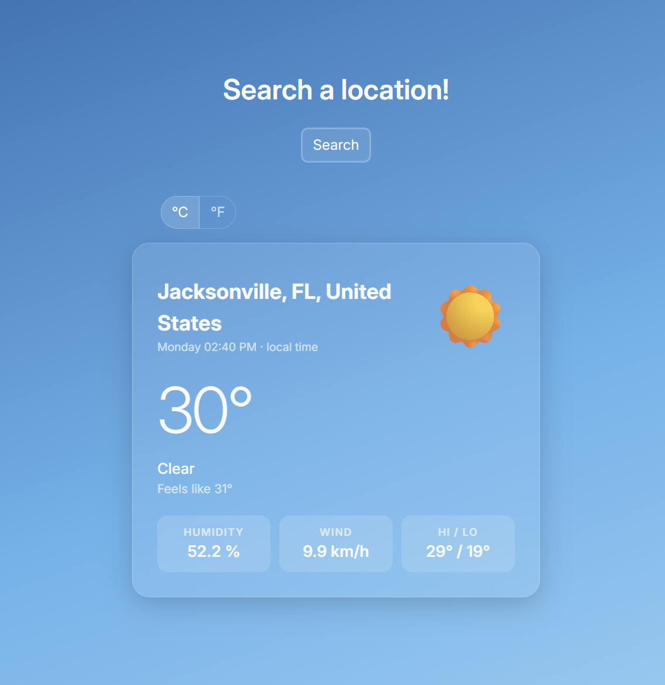
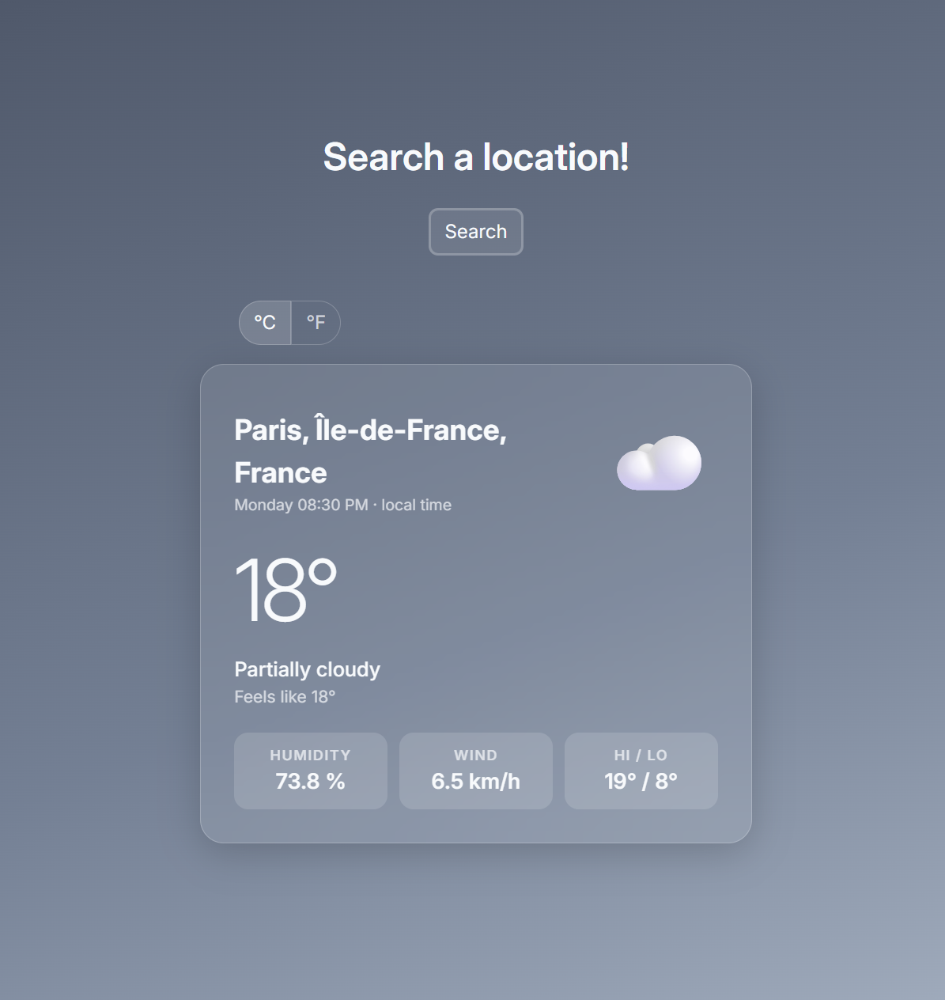
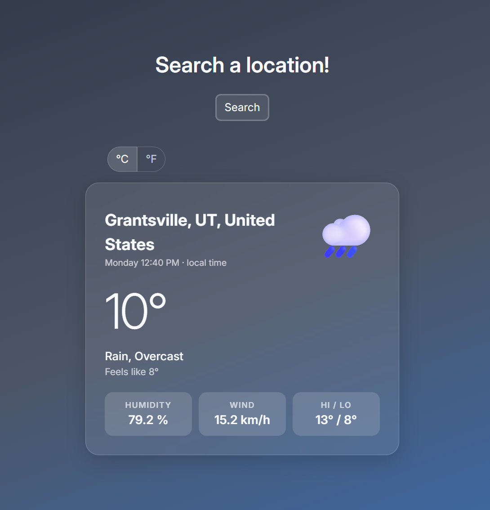

Weather app readme · MD

# Weather App

A weather search app built with vanilla JavaScript. Enter a city and country to get current conditions from the Visual Crossing API — temperature, feels-like, humidity, wind, and high/low — with the background adapting to the weather and a toggle between Celsius and Fahrenheit.

**[Live demo →](https://dani-sink.github.io/project-weather-app/)**

### Clear



### Cloudy



### Rain



## Features

- **Search by city + country** with a clean, validated form
- **Live weather data** from the **[Visual Crossing API](https://www.visualcrossing.com/)** — temp, condition, feels-like, humidity, wind, high/low, local time
- **Loading state** while the request is in flight
- **Friendly error handling** — unknown locations and failed requests show a clear message instead of breaking
- **°C / °F toggle** that converts instantly (no extra network request)
- **Condition-based backgrounds** — the gradient shifts to match the weather (clear day/night, cloudy, rain, snow, thunder, fog)
- **Weather icons** mapped from the API's condition codes

## What it demonstrates

- **Working with a third-party API** — building the request URL, `fetch`, and handling the response
- **Async JavaScript** — promises, `async`/`await`, and reacting to pending / fulfilled / rejected states in the UI
- **Robust error handling** — checking `response.ok` (since `fetch` doesn't reject on 4xx), input validation, and graceful failure messages
- **Separation of concerns** — API module, display/DOM module, and app logic kept in separate modules
- **Clean data shaping** — extracting a flat, display-ready object from a large nested API response
- **Display-state vs data** — the unit toggle converts at render time rather than re-fetching

## Built with

- Vanilla JavaScript (ES6 modules)
- Webpack (split dev / prod config)
- HTML & CSS (custom properties for theming)
- **[Visual Crossing Weather API](https://www.visualcrossing.com/)**

## Running locally

```bash
git clone https://github.com/dani-sink/weather-app.git
cd weather-app
npm install
npm run dev      # dev server at localhost:8080
```

> This project uses a free-tier Visual Crossing API key on the client side (The key is rate-limited and carries no billing). In a production app the key would live on a backend proxy so it never reaches the browser.

## What I learned

- `fetch()` doesn't reject on 404/400 — you have to check response.ok yourself
- Using `URLSearchParams()` and `encodeURIComponent()` to build the URL for the API request.
- Shaping the huge API response into a small clean object before touching the DOM.
- Converting units at display time instead of re-fetching
- Building a Webpack project with ESLint and Prettier
- Building a glass-like card components that adapts to dynamically-changed backgrounds.

## What I'd improve next

- Add CSS-animated weather effects (rain, snow, fog, lightning) once I'm more comfortable with keyframe animations and pseudo-element layering
- Move the API key to a backend proxy so it isn't exposed client-side
- Save recent searches / support multiple saved locations
